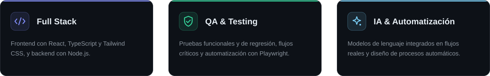
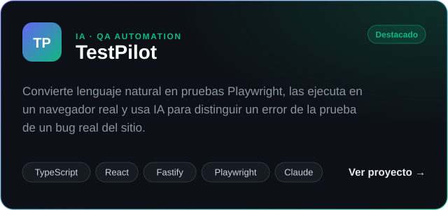
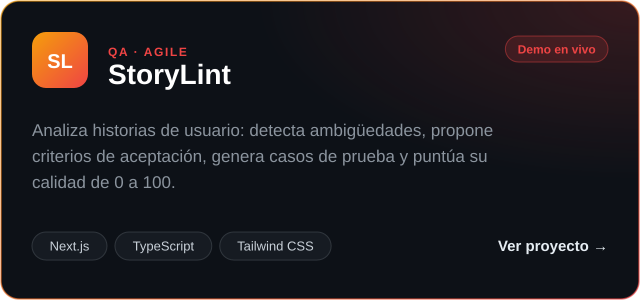
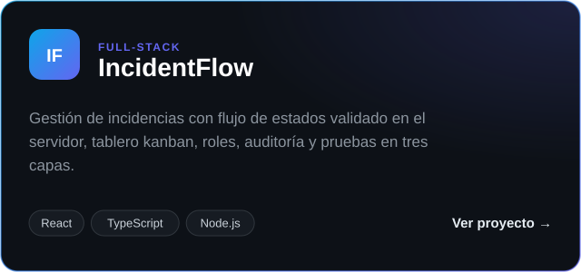
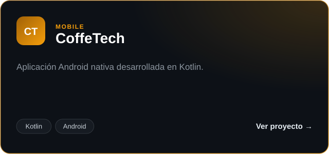

  

  
  

 

## Lo que hago

Ingeniero de software **full stack** con experiencia en desarrollo frontend (JavaScript, React, TypeScript y Tailwind CSS), backend con Node.js, **aseguramiento de calidad (QA)**, levantamiento de requerimientos y documentación técnica, forjada en proyectos del **sector público** y en aplicaciones propias.

Me enfoco en construir **productos confiables** mediante testing riguroso y automatización de procesos, con conocimientos complementarios en Machine Learning y NLP. Español nativo, inglés en progreso.

## Tecnologías

  
    
  
    
  
  
  

## Proyectos

  
  

  
  

## Actividad

  

  <picture>
    <source media="(prefers-color-scheme: dark)" srcset="https://raw.githubusercontent.com/KevinEduardoS/KevinEduardoS/output/github-snake-dark.svg" />
    
  </picture>

  <b>¿Construimos algo juntos?</b> 
  <a href="https://kevin-samboni-portfolio.vercel.app">kevin-samboni-portfolio.vercel.app</a>

